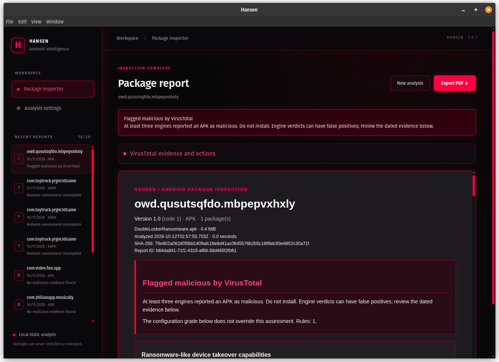
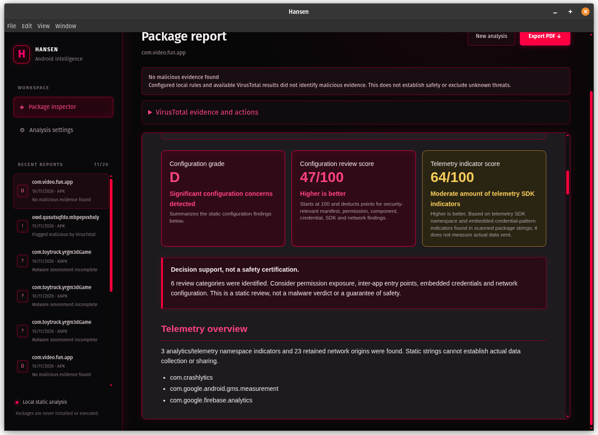

# Hansen
### "You see how this looks, right?"

Hansen is a desktop application for static inspection of Android APK and XAPK packages. It presents an in application report and supports PDF export.

## Screenshots

| Malware and reputation evidence | Configuration and telemetry assessment |
| --- | --- |
| [](docs/screenshots/hansen-malware-report.png) | [](docs/screenshots/hansen-score-overview.png) |

Select either screenshot to open the full-size image.

## Scoring and grades

Hansen displays a separate malware assessment before the configuration grade. A favorable letter grade cannot override a malware warning. Older reports without this assessment must be scanned again.

The report assigns a heuristic static review score from 0 to 100. It starts at 100 and subtracts 25 points for each high severity finding category, 10 for each medium category, and 3 for each low category. Informational findings do not reduce the score. The letter grade is A for 90 or higher, B for 75 to 89, C for 60 to 74, D for 40 to 59, and F below 40. The separate telemetry indicator score starts at 100, subtracts 8 points for each identified analytics or telemetry SDK up to 48 points, and 12 points when potential credential patterns are found. Both scores are bounded between 0 and 100.

These scores summarize configured static indicators. They are not probabilities, malware detections, or certifications of safety. A high score does not prove that an APK is harmless, and a low score does not prove malicious intent.

## Malware assessment and VirusTotal

Local rules identify combinations of capabilities associated with ransomware, persistent overlays, SMS abuse, and destructive commands. Matches are reported as potentially malicious, with evidence and limitations. Legitimate software can share these capabilities; filenames and package names do not determine the verdict. Static analysis does not prove that a code path executes.

Enable VirusTotal hash lookups in Analysis settings and enter your own API key to add reputation evidence. Hansen sends exact APK SHA-256 hashes, including individual APKs inside XAPK containers. It checks up to four unique APKs automatically; unchecked splits remain visible and can be checked individually from the report. Requests are spaced by at least 16 seconds and quota failures are reported.

Three or more malicious engine detections produce “Flagged malicious by VirusTotal.” One or two malicious detections, any suspicious detection, or a local malware rule produce “Potentially malicious.” These are Hansen policy thresholds, not certainty or independent engine consensus. “No malicious evidence found” requires completed results less than 30 days old for every APK, with at least one harmless or undetected result per APK and no local or remote flags. All other negative cases remain incomplete. An undetected engine result is not a safety endorsement. Previous detections remain visible when a refresh fails or a new scan is pending.

The report offers an optional APK upload. Hansen asks you to select the original package, verifies its hash, and requests confirmation before sending any file. VirusTotal may retain and share submitted files. For XAPK containers, only the selected contained APK is uploaded. Uploads are limited to 650 MiB; use Check status to retrieve the completed result. Uploading does not automatically produce a verdict.

VirusTotal requires an account and API key. Its [public API terms](https://docs.virustotal.com/reference/public-vs-premium-api) prohibit commercial product use; commercial deployments require an appropriate licensed account. [File submission documentation](https://docs.virustotal.com/reference/files-scan) describes limits and data sharing. Local analysis remains available without VirusTotal. Optional AI commentary cannot override the malware assessment.

## Safety review

Hansen inspects package manifests and bounded strings in package files. It looks for debug builds, cleartext traffic settings, sensitive permission declarations, exported components, backup settings, known analytics SDK indicators, embedded HTTP URL strings, potential credential patterns, and code capabilities such as reflection or dynamic class loading. Reports include matched evidence and recommended review actions. The app does not install or execute the APK.

Static analysis has important limits. A declared permission does not show that it was granted or used. An exported component may be intentional or protected by checks not evaluated by this scan. A URL or SDK string does not prove a network connection or data collection, and credential patterns may be false positives. Obfuscation, encrypted or generated code, unsupported file formats, and scan coverage limits can hide behavior. Treat findings as prompts for review, not a final verdict. Do not install an untrusted APK on a device you rely on; use an isolated test environment for any dynamic analysis.

## Requirements

Node.js 22.12 or later with npm 10 or later. The repository selects Node.js 24 through `.nvmrc`. If your terminal uses an older version, follow the [Node.js setup instructions](apk-analyzer/LAUNCH_GUIDE.md#nodejs-setup) before installing dependencies.

## Build and run

From `apk-analyzer`, install dependencies and start the application:

```bash
npm ci --include=optional
npm run build
npm start
```

Local analysis is available without an AI service. See the [application guide](apk-analyzer/README.md), [architecture](apk-analyzer/ARCHITECTURE.md), and [validation results](apk-analyzer/TEST_RESULTS.md).

## License

Apache License 2.0. See [LICENSE](LICENSE).
